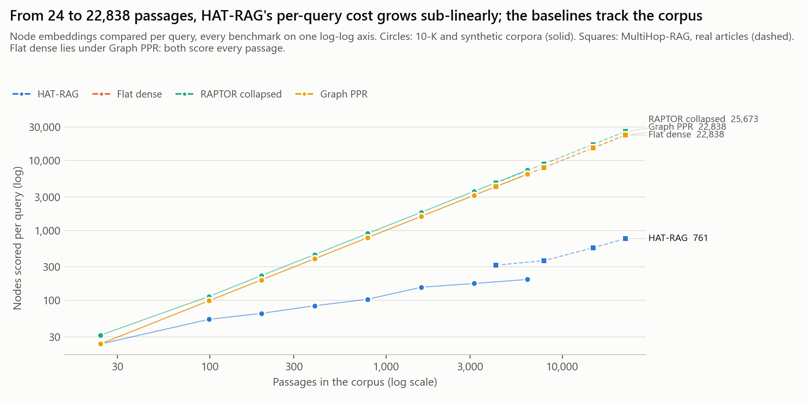

# HAT-RAG: Hierarchical Abstract Tree retrieval for large document collections

HAT-RAG indexes a document collection as a tree. Passages sit at the leaves, and each
internal node holds an abstract of the cluster below it. A question is answered by a
beam search down that tree, followed by a small graph walk over the passages the search
reached. Each query therefore compares itself against a small, slowly growing part of
the index rather than against every passage. An LLM (Groq or Gemini) then writes a cited
answer from the retrieved evidence.

This repository has four parts:

- the index builder (Algorithms 1 and 3)
- four interchangeable retrievers over the same index: HAT-RAG and three published
  baselines
- an evaluation harness, run on three benchmarks from 24 to 22,838 passages
- a Streamlit app where you can ask the knowledge base any question



---

## Results at a glance

Recall@5 is the share of a question's labelled evidence passages that appear in the
retriever's top 5. "Nodes scored" is how many embeddings the retriever compares against
the question, which is the cost measure.

| Benchmark | Passages | HAT-RAG | Flat dense | RAPTOR | Graph PPR | HAT-RAG nodes scored |
|---|---:|---:|---:|---:|---:|---:|
| SEC 10-K summaries, 52 questions | 24 | **85.0%** | 83.9% | 74.6% | 83.4% | 24 (all) |
| Synthetic dossiers, 128 docs | 1,582 | **96.2%** | 77.4% | 75.0% | 88.9% | 154 (10%) |
| Synthetic dossiers, 512 docs | 6,332 | **97.6%** | 50.8% | 49.7% | 88.3% | 199 (3%) |
| **MultiHop-RAG**, real news, 1,789 held-out questions | **22,838** | 20.5% | 20.9% | 19.9% | **23.7%** | 936 (3.6%) |

What the numbers say:

1. **On the synthetic corpora HAT-RAG is the clear winner, and the gap widens with
   size.** From 1,582 to 6,332 chunks, flat dense retrieval falls from 77% to 51%, while
   HAT-RAG stays at 96 to 98%. Its cost grows from 154 to 199 nodes while the corpus
   grows 4×. These corpora are generated to defeat surface similarity: every document
   shares the same boilerplate sentences.
2. **On MultiHop-RAG, a real 1.06M-word news archive, HAT-RAG is not the most accurate.**
   It matches flat dense retrieval and RAPTOR, within a point, while scoring 3.6% of the
   index. Graph PPR, the GraphRAG/HippoRAG family, leads by about 3 points. It pays for
   that by scoring every passage and walking the whole-corpus graph (69 ms per query,
   against 2.6 ms for flat).

   A growing-haystack test holds 761 questions fixed while the corpus grows from 4,207
   to 22,838 passages:
   - Every method loses about 2.5 points, and none collapses as flat does on the
     synthetic data.
   - HAT-RAG's cost grows 2.4× while the corpus grows 5.4×.
   - HAT-RAG has the best MRR at the three larger sizes: when it finds evidence, it
     ranks it first more often.
3. **The cost advantage is real and grows with the corpus; the accuracy advantage
   depends on the data.** HAT-RAG wins clearly where many documents look alike and
   entities identify the right one. On free-form news with question-specific wording, a
   tuned graph walk over everything still finds more evidence.
4. **End-to-end answers** follow the same order. On 45 held-out MultiHop-RAG questions
   answered by gpt-oss-120b, accuracy was 35.6% for HAT-RAG, 44.4% for flat dense, 35.6%
   for RAPTOR and 46.7% for Graph PPR. The sample is small (about ±14 points), so read
   it as consistent with the retrieval result, not as a separate finding.

The full method, every table, the ablations and the limitations are in
[`algorithms/compare-algos/README.md`](algorithms/compare-algos/README.md).

---

## Quick start

```bash
git clone https://github.com/nivesh4087-spec/HAT-RAG-CUDA.git
cd HAT-RAG-CUDA
python -m venv .venv && .venv\Scripts\activate        # Linux/macOS: source .venv/bin/activate
pip install -r requirements.txt

cp .env.example .env          # then put GROQ_API_KEY=... (and optionally GEMINI_API_KEY=...) in .env
streamlit run app.py          # http://localhost:8501
```

The 10-K and synthetic trees ship with the repository. The MultiHop-RAG tree (25,673
nodes, about 70 MB) is built locally the first time. It downloads 12 MB of data and
takes about 20 minutes on a CPU:

```bash
python algorithms/compare-algos/run_multihop.py --build-only
```

No GPU is needed: every number in this README was produced on CPU. The code runs on a
CUDA device unchanged when one is present.

---

## The app

| Tab | What it does |
|---|---|
| **Ask** | Ask any question in your own words. Pick the retriever (HAT-RAG by default), and the answer streams back with numbered citations. A status line shows how much of the index was searched and how long each step took. Follow-up questions keep a little conversational context. |
| **Compare retrievers** | Run one question through all four retrievers side by side: nodes scored, share of the index, latency and the evidence each one found. Choose a benchmark question to see which retriever actually found the labelled evidence, and optionally have the LLM answer from each method's evidence. |
| **Benchmarks** | The evaluation results as interactive charts and tables. |
| **Corpus & tree** | Browse documents, their passages, parents and alpha links, and the tree's level sizes. |
| **Build** | Rebuild the 10-K and synthetic trees; the command for the MultiHop-RAG tree. |

Three knowledge bases are available from the sidebar:

- **MultiHop-RAG news archive**: 609 articles from 49 publishers.
- **Synthetic engineering dossiers**: 128 documents.
- **SEC 10-K summaries**: Apple, Amazon, Microsoft, NVIDIA and Tesla.

**LLM setup.** Keys are read from `.env`. Provider "Auto" uses Groq and falls back to
Gemini when Groq is missing or rate-limited. The model is chosen from what your account's
`/models` endpoint offers; set `GROQ_MODEL` / `GEMINI_MODEL` to pin one. "Sources only"
makes the model answer strictly from the retrieved passages. "Sources + general
knowledge" lets it fill gaps, and marks those parts.

From the command line:

```bash
python algorithms/llm_answer.py --query "Compare the R&D spending of Apple and NVIDIA."
python algorithms/llm_answer.py --tree data/multihop_rag/trees/hat_multihop_full.json \
    --query "Who is facing a fraud trial according to The Verge and TechCrunch?"
```

---

## How it works

```
OFFLINE                                         ONLINE (per question)
documents                                       question -> same encoder
  -> Algorithm 1: sentence-window chunks          -> 1. descend: beam search ROOT -> leaves (beta abstracts kept per level;
  -> encoder: all-MiniLM-L6-v2, d = 384                  alpha edges let the beam step sideways)
  -> Algorithm 3: spherical k-means per level     -> 2. link: passages naming an entity the question names
     -> an abstract per cluster                   -> 3. expand: alpha and reading-order neighbours of the best passages
     -> alpha edges between related nodes         -> 4. propagate: personalised PageRank on the candidate subgraph only
        under different parents                   -> 5. select: top-k with a relevance-gated diversity bonus
  -> tree H (JSON + .emb.npy)                     -> numbered evidence -> LLM -> cited answer
```

The three baselines read the same tree, chunks and vectors:

| Retriever | Family | What it scores per query |
|---|---|---|
| HAT-RAG (ours) | hierarchical beam search + graph propagation | the nodes the descent reaches, plus entity-linked passages |
| Flat dense | vanilla RAG / DPR | every passage |
| RAPTOR collapsed | RAPTOR | every node at every level |
| Graph PPR | GraphRAG / HippoRAG | every passage, then a PageRank walk over the whole passage graph |

Algorithm details: [`ALGORITHMS.md`](ALGORITHMS.md) and [`algorithms/README.md`](algorithms/README.md).

---

## Benchmarks

| Benchmark | Source | Size | Questions |
|---|---|---|---|
| SEC 10-K summaries | 2024 filings of five companies, condensed | 5 docs, 24 passages | 52, hand-labelled |
| Synthetic dossiers | generator from the IBERAMIA paper, planted facts + cross-document bridges | 8 to 512 docs, 99 to 6,332 passages | 44 to 296 per size |
| **MultiHop-RAG** | Tang & Yang, COLM 2024 ([paper](https://arxiv.org/abs/2401.15391), [data](https://huggingface.co/datasets/yixuantt/MultiHopRAG), ODC-BY) | 609 articles, 1.06M words, 22,838 passages | 2,255 with evidence in 2 to 4 articles; 466 dev / 1,789 test |

MultiHop-RAG is the benchmark for the "large collection" question. Its settings were
chosen on the dev split only (`tune_multihop_dev.py`, rule fixed before running), and
every number above is from the test split.

```bash
python algorithms/compare-algos/run_comparison.py --sizes 8 16 32 64 128 256 512   # 10-K + synthetic
python algorithms/compare-algos/tune_multihop_dev.py                                # dev-split settings
python algorithms/compare-algos/run_multihop.py                                     # MultiHop-RAG
python algorithms/compare-algos/run_answer_eval.py --per-type 15                    # answers (needs a key)
python algorithms/compare-algos/make_figures.py                                     # figures + tables.md
python -m pytest -q tests                                                           # 14 tests
```

---

## Repository layout

```
app.py                      Streamlit app (Ask / Compare / Benchmarks / Corpus / Build)
webapp/                     app styling and Plotly charts
algorithms/
  algo1_document_chunking.py          Algorithm 1: chunking
  algo3_hierarchical_abstract_tree.py Algorithm 3: encoder, k-means, abstracts, alpha edges
  retrieval1_hat_beam_traversal.py    HAT-RAG retriever + the shared TreeIndex
  retrieval2_flat_dense.py            baseline: flat dense
  retrieval3_raptor_collapsed_tree.py baseline: RAPTOR collapsed tree
  retrieval4_graph_ppr.py             baseline: entity graph + personalised PageRank
  llm_answer.py                       generation: Groq / Gemini, cited answers
  compare-algos/                      benchmarks, results/, figures/, report
data/multihop_rag/          downloaded dataset and built tree (git-ignored)
finance_data/reports/       the five 10-K summaries
tests/                      unit tests, including the large-corpus code paths and the LLM layer
src/, hat_rag/              earlier prototype package (FastAPI service, run_app.py); not used by the app or benchmarks
```

---

## Limitations

- **HAT-RAG is not the most accurate retriever on MultiHop-RAG.** Graph PPR finds about
  3 points more evidence at k = 5. Narrowing that gap is open work. The candidates are
  query decomposition (one descent per sub-question), a stronger encoder than
  MiniLM-L6, and a reranker; each would also have to be tested on the baselines.
- **Fewer nodes scored is not lower latency on a CPU at these sizes.** One mat-vec over
  22,838 vectors takes about 2 ms, while HAT-RAG's descent, linking and PageRank cost
  about 70 ms in Python. A link cap chosen on the same dev grid brings HAT-RAG to about
  8 ms, for about 0.5 points of recall. The node-count advantage only turns into a time
  advantage at corpus sizes where flat search needs an ANN index. No ANN baseline was
  tested here.
- **The synthetic corpora are built to defeat surface similarity,** and their questions
  name exact project codes. Graph PPR has the same entity linking, so it is the fair
  comparison there.
- **Absolute recall on MultiHop-RAG is low for every method** (20 to 24% at k = 5, 26
  to 30% at k = 10). Questions need 2 to 4 evidence passages, and the encoder is small.
  The comparison between methods is the point, not the absolute level.
- The end-to-end answer sample is 45 questions. Use the retrieval numbers for
  conclusions.
