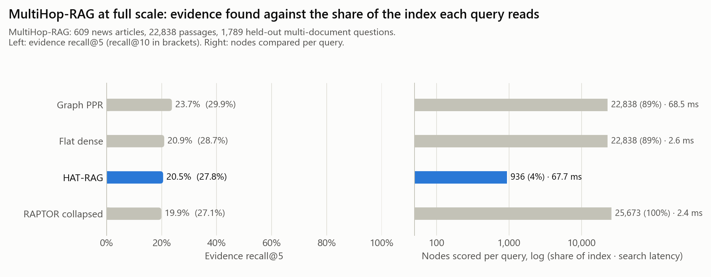
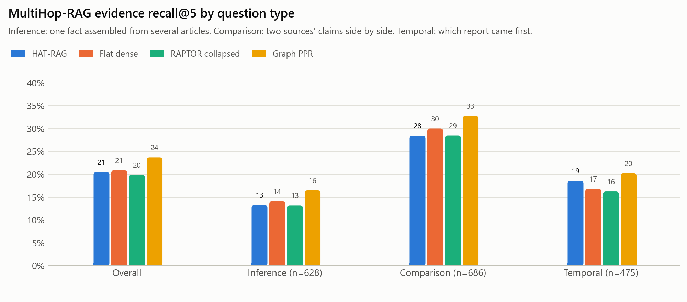
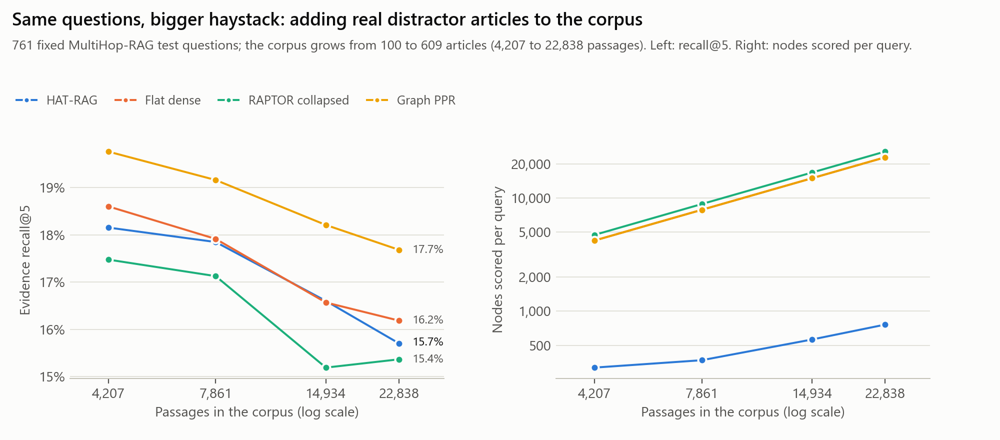
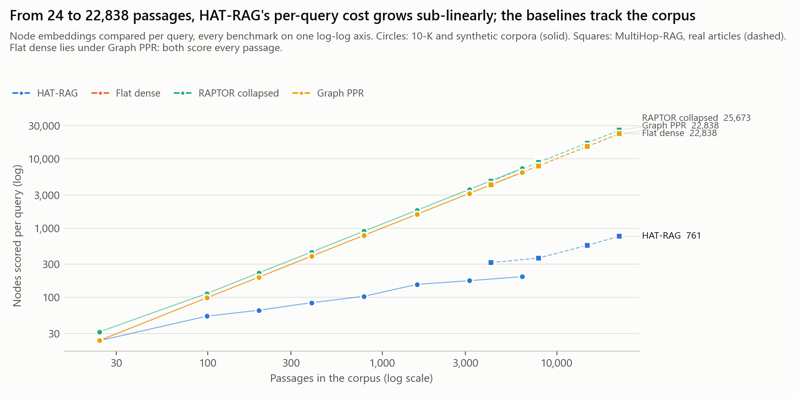
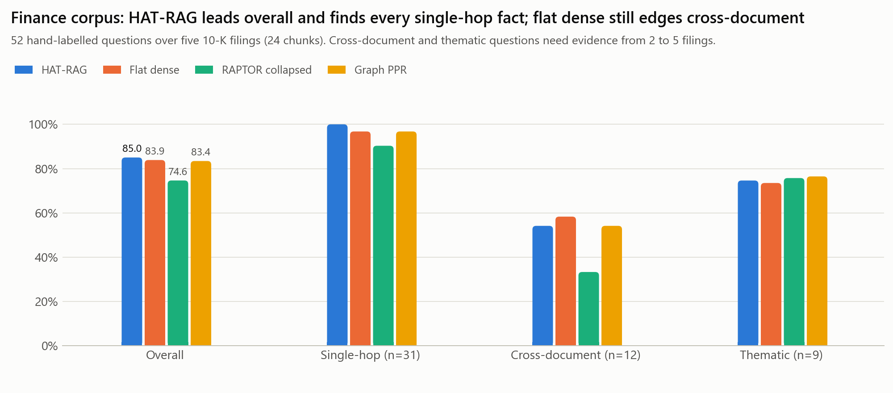
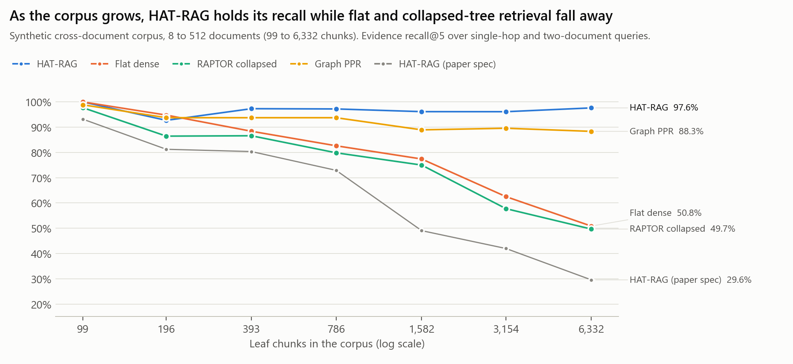
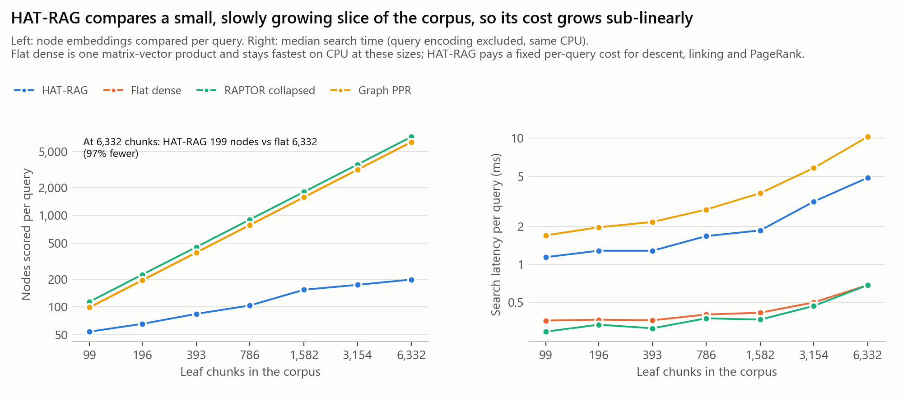
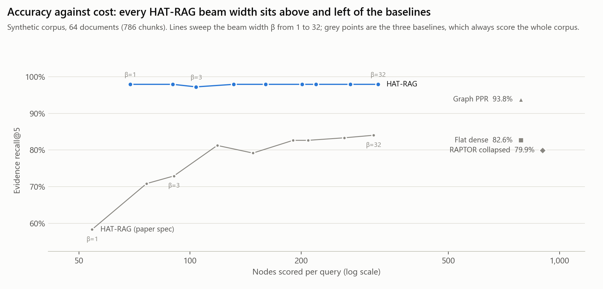
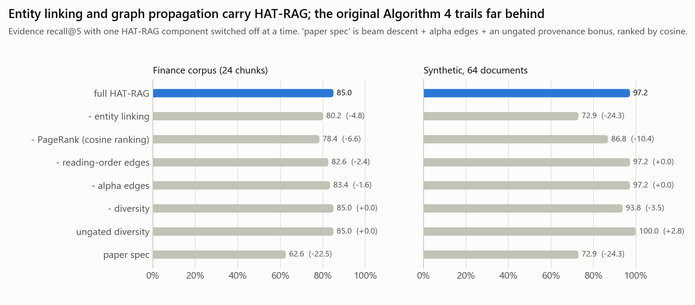

# Retrieval Algorithm Comparison

Four retrieval techniques are built over the same Hierarchical Abstract Tree and
evaluated on the same questions:

| # | File | Technique | Family |
|---|---|---|---|
| 1 | [`retrieval1_hat_beam_traversal.py`](../retrieval1_hat_beam_traversal.py) | **HAT-RAG**: beam descent of the tree + entity linking + personalised PageRank over the tree's own edges | ours |
| 2 | [`retrieval2_flat_dense.py`](../retrieval2_flat_dense.py) | Flat dense retrieval: cosine against every chunk | DPR / vanilla RAG |
| 3 | [`retrieval3_raptor_collapsed_tree.py`](../retrieval3_raptor_collapsed_tree.py) | Collapsed tree: every level of the tree pooled, cosine top-k | RAPTOR |
| 4 | [`retrieval4_graph_ppr.py`](../retrieval4_graph_ppr.py) | Entity graph + personalised PageRank over the whole corpus | GraphRAG / HippoRAG |

The comparison uses three benchmarks:

- **A. 10-K filings:** 24 chunks.
- **B. Synthetic dossiers:** 8 to 512 documents, up to 6,332 chunks.
- **C. MultiHop-RAG:** 609 real news articles, 22,838 passages. This is the
  large-collection benchmark.

A fourth benchmark, **D**, checks end-to-end answers with an LLM.

## Verdict

**On A and B, HAT-RAG is the best of the four, and its lead grows with corpus size. On
C, the real archive, it is not:** it ties flat dense and RAPTOR while scoring 3.6% of
the index, and Graph PPR leads by about 3 points of recall.

| Method | A: 10-K recall@5 | B: synthetic recall@5, mean of 7 sizes | B at 512 docs | **C: MultiHop-RAG recall@5 (test)** | C: share of the 25,673 tree nodes scored | C: latency |
|---|---:|---:|---:|---:|---:|---:|
| **HAT-RAG** | **85.0%** | **96.7%** | **97.6%** | 20.5% | **3.6%** | 68 ms |
| Graph PPR | 83.4% | 92.4% | 88.3% | **23.7%** | 89% (every passage) | 69 ms |
| Flat dense | 83.9% | 79.5% | 50.8% | 20.9% | 89% (every passage) | **2.6 ms** |
| RAPTOR collapsed | 74.6% | 76.2% | 49.7% | 19.9% | 100% (every node) | 2.4 ms |

The ranking rule for A + B was written into `run_comparison.py` before any run:
½ × finance recall@5 + ½ × mean synthetic recall@5, with ties within one point ordered
by cost. Under it HAT-RAG scores 90.9, Graph PPR 87.9, flat 81.7 and RAPTOR 75.4. C was
added afterwards to test the claim that matters for large collections. It is reported
separately rather than folded into that rule, so the rule is not changed after the fact.



---

## What the evidence shows

1. **Cost: HAT-RAG is the only sub-linear method, on every benchmark.**
   - Synthetic: it scores 54 nodes at 99 chunks and 199 at 6,332 (3%), while the corpus
     grows 64×.
   - MultiHop-RAG: it scores 936 of 25,673 nodes per query. The three baselines score
     the whole corpus, or more.
2. **Accuracy on generated data: HAT-RAG holds while the others decay.** From 99 to
   6,332 chunks, flat dense falls from 100% to 50.8% and RAPTOR to 49.7%. Graph PPR
   settles around 88%, and HAT-RAG stays between 92.7% and 97.6%.
3. **Accuracy on real data: no win.** On 1,789 held-out MultiHop-RAG questions, HAT-RAG
   reaches 20.5% recall@5 against 20.9% for flat dense, 19.9% for RAPTOR and 23.7% for
   Graph PPR.
   - At k = 10 the results are 27.8%, 28.7%, 27.1% and 29.9%.
   - Per question against flat dense, HAT-RAG is better 139 times and worse 155 times:
     a statistical tie.
   - Against Graph PPR it is better 135 times and worse 262 times.
   - It has the second-best MRR (0.304, behind Graph PPR's 0.320), and it beats flat
     dense on temporal questions (18.6% vs 16.8%).
4. **Fewer nodes is not less time on a CPU at these sizes.** One 22,838 × 384
   matrix-vector product takes 2.6 ms. HAT-RAG spends about 68 ms per query, mostly in
   PageRank over candidate pools of about 900 passages, which entity linking inflates.
   Capping that linking (below) brings it to about 8 ms.
5. **The original Algorithm 4 from the paper ranks last everywhere:** 62.6% on 10-K,
   29.6% at 512 synthetic documents, 10.7% on MultiHop-RAG. The version that wins on A
   and B is what that design became after this comparison showed why it failed (see
   [How HAT-RAG got here](#how-hat-rag-got-here)).

---

## Setup

**Shared index.** Every method reads one `TreeIndex` built from the Algorithm 3 tree:

- the same chunks (Algorithm 1)
- the same encoder (`all-MiniLM-L6-v2`, d = 384)
- the same vectors

Each query is encoded once and handed to every method, so latency measures search
alone. Flat dense and Graph PPR use only the leaves; RAPTOR and HAT-RAG also use the
abstract nodes. Every baseline scores against a contiguous, precomputed matrix with a
partial top-k sort, so its timing reflects the algorithm and not avoidable copying.

**A. 10-K corpus.** These are the five 10-K summaries in
[`finance_data/reports/`](../../finance_data/reports/) and the tree `run_finance_rag.py`
built from them: 24 chunks, 32 nodes, BART abstracts. There are 52 hand-labelled
questions in [`finance_queries.json`](finance_queries.json):

- 31 single-hop
- 12 cross-document
- 9 thematic, spanning 2 to 5 filings

**B. Synthetic scaling.** This is the paper's cross-document generator
([`synthetic_corpus.py`](synthetic_corpus.py)) at 8, 16, 32, 64, 128, 256 and 512
documents (99 to 6,332 chunks):

- Questions are single-hop, or two-document, where the second document is linked only
  through a bridge sentence.
- A fresh tree is built at each size (b = 8, extractive abstracts).
- Every document shares the same distractor sentences, so near-identical chunks compete
  as the corpus grows.

**C. MultiHop-RAG** (Tang & Yang, COLM 2024; [paper](https://arxiv.org/abs/2401.15391),
[data](https://huggingface.co/datasets/yixuantt/MultiHopRAG), ODC-BY) is loaded by
[`multihop_corpus.py`](multihop_corpus.py).

- **Corpus:** 609 articles from 49 publishers, 1.06M words, chunked into 22,838 passages
  (tree: 25,673 nodes over 6 levels).
- **Questions:** the 2,255 that have evidence spread over 2 to 4 articles, typed as
  inference, comparison or temporal. The 301 unanswerable "null" questions are excluded.
- **Chunk headers:** every chunk starts with `[publisher, Mon YYYY] title.`, because
  questions refer to that metadata ("…as reported by TechCrunch in October 2023"). All
  four retrievers see the same text.
- **Splits:** every fifth question is **dev** (466 questions) and the rest are **test**
  (1,789). The dev split is the only data used for any design decision; every number
  reported for C is from the test split.

**Gold matching (strict).** A gold item is found when a retrieved node belongs to the
right document *and its own text* holds the evidence:

- **A, B:** at least 60% of the item's key terms.
- **C:** at least 50% of the labelled evidence sentence's word 3-grams. All 6,084
  evidence sentences occur verbatim in some chunk, about one chunk each.

Returning the right article's wrong paragraph does not count. An abstract gets no credit
for text that only its children contain.

**Metrics.**

| Metric | Definition |
|---|---|
| Recall@k (primary) | Fraction of a question's gold items present in the top k |
| Hit@k | At least one gold item present |
| All gold found | Every gold item present |
| MRR | 1 / rank of the first correct node |
| Precision | Fraction of the top k that come from a gold document |
| Nodes scored | Embeddings compared against the query: the cost measure |
| Latency | Median search time over 3 to 7 runs, query encoding excluded, single CPU process |

**Settings.**

- k = 5 for every method; C also reports k = 10.
- HAT-RAG on A and B uses the paper's β = 3 and λ = 0.15, untuned.
- Graph PPR uses damping 0.5 (the HippoRAG default), semantic edges at cosine ≥ 0.45
  with the top 4 neighbours, and reading-order edges.
- HAT-RAG on C uses β = 5 and 6 PageRank seeds, picked on the dev split (next section).

---

## Results

### C. MultiHop-RAG: 22,838 real passages



| Method | Recall@5 | Recall@10 | Hit@5 | MRR | Nodes scored | Share of index | Latency |
|---|---:|---:|---:|---:|---:|---:|---:|
| HAT-RAG | 20.5% | 27.8% | 45.3% | 0.304 | **936** | **3.6%** | 67.7 ms |
| Flat dense | 20.9% | 28.7% | 45.5% | 0.297 | 22,838 | 89% | 2.6 ms |
| RAPTOR collapsed | 19.9% | 27.1% | 43.2% | 0.284 | 25,673 | 100% | 2.4 ms |
| Graph PPR | **23.7%** | **29.9%** | **49.4%** | **0.320** | 22,838 | 89% | 68.5 ms |
| *HAT-RAG (paper spec)* | *10.7%* | *15.8%* | *25.4%* | *0.173* | *203* | *0.8%* | *1.4 ms* |

| Method (recall@5) | Inference (n=628) | Comparison (n=686) | Temporal (n=475) |
|---|---:|---:|---:|
| HAT-RAG | 13.3% | 28.5% | 18.6% |
| Flat dense | 14.1% | 30.0% | 16.8% |
| RAPTOR collapsed | 13.2% | 28.5% | 16.2% |
| Graph PPR | **16.5%** | **32.8%** | **20.2%** |


**Choosing the large-corpus setting on dev.** The paper's β = 3 was set on a 32-node
tree. [`tune_multihop_dev.py`](tune_multihop_dev.py) evaluated 24 settings on the 466
dev questions only:

- **Settings tried:** β ∈ {3, 5, 8, 12}; entity-link cap ∈ {none, 50, 200}; PageRank
  seeds ∈ {3, 6}.
- **Selection rule, fixed in the script before it ran:** highest dev recall@5, and
  within 0.5 points the cheaper setting wins.
- **Results on dev:**
  - Every HAT-RAG setting scored between 16.6% and 20.7%.
  - Flat dense scored 19.4% and Graph PPR 21.4%.
  - **No HAT-RAG setting beat Graph PPR on dev.** The rule picked β = 5 with 6 seeds
    (20.4% dev).

All 24 rows are in [`results/multihop_dev_tuning.json`](results/multihop_dev_tuning.json).

**The link cap, a latency option.** Every chunk names its publisher, so a question that
names "TechCrunch" links thousands of passages into HAT-RAG's candidate pool, and the
PageRank over that pool dominates its 68 ms. With `max_link=200`, an entity named in more
than 200 passages only marks the candidates it appears in. It does not pull its whole
posting list in. On dev this scored 20.0% at 262 nodes and **8.5 ms**, a 10× speed-up
for about half a point of recall.

**Ablations on test (k = 5).**

| Variant | Recall@5 | Nodes scored |
|---|---:|---:|
| full HAT-RAG (β = 5, 6 seeds) | 20.5% | 936 |
| − entity linking | 14.7% | 293 |
| − PageRank (rank by cosine) | 20.2% | 936 |
| − reading-order edges | 20.5% | 935 |
| − alpha edges | 19.6% | 845 |
| − diversity | 20.5% | 936 |
| paper spec | 10.7% | 203 |

Entity linking carries HAT-RAG on real data too: without it, recall drops 5.8 points.
Alpha edges add about a point. Unlike on the synthetic data, PageRank adds only 0.3
points here.

**Beam width on test.** Recall@5 rises with β, while nodes scored grow from 765 to
1,271:

| β | 1 | 2 | 3 | 5 | 8 | 16 |
|---|---:|---:|---:|---:|---:|---:|
| Recall@5 | 18.5% | 19.8% | 20.0% | 20.5% | 20.9% | 20.9% |

It never reaches Graph PPR's 23.7%. The capped-link variant (β = 3, `max_link=200`)
scores 19.8% at 262 nodes.

**Growing haystack.** This test holds the questions fixed and adds real articles:

- **Questions:** 761 test questions whose evidence all lies in the first 100 articles.
- **Corpus:** grown to 200, 400 and all 609 articles (4,207 → 22,838 passages), with a
  tree rebuilt at each size.



| Recall@5 · nodes scored | 4,207 | 7,861 | 14,934 | 22,838 passages |
|---|---:|---:|---:|---:|
| HAT-RAG | 18.2% · 318 | 17.8% · 369 | 16.6% · 563 | 15.7% · 761 |
| HAT-RAG, capped links | 16.3% · 225 | 16.1% · 224 | 15.8% · 284 | 15.6% · 242 |
| Flat dense | 18.6% · 4,207 | 17.9% · 7,861 | 16.6% · 14,934 | 16.2% · 22,838 |
| RAPTOR collapsed | 17.5% · 4,718 | 17.1% · 8,839 | 15.2% · 16,776 | 15.4% · 25,673 |
| Graph PPR | **19.8%** · 4,207 | **19.2%** · 7,861 | **18.2%** · 14,934 | **17.7%** · 22,838 |

What the haystack shows:

- **Every method loses about 2.5 points as real distractors are added,** and none
  collapses. That is unlike the synthetic corpus, where flat dense halved. Real
  articles are not near-duplicates of each other, so surface similarity keeps working.
- **The ordering holds at every size.**
- **HAT-RAG's cost grows 2.4× while the corpus grows 5.4×.** The capped variant stays
  flat at about 240 nodes and 9 ms. At full size it gives up only 0.1 points against
  uncapped HAT-RAG.
- **HAT-RAG has the best MRR at 200, 400 and 609 articles** (0.295, 0.289 and 0.285,
  against Graph PPR's 0.291, 0.277 and 0.268). When it finds the evidence, it ranks it
  first more often.



### A. 10-K corpus



| Method | Recall@5 | Hit@5 | All gold found | MRR | Precision | Nodes scored |
|---|---:|---:|---:|---:|---:|---:|
| **HAT-RAG** | **85.0%** | **90.4%** | **78.8%** | 0.660 | 67.7% | 23.9 |
| Flat dense | 83.9% | 90.4% | 75.0% | 0.677 | 62.3% | 24.0 |
| RAPTOR collapsed | 74.6% | 76.9% | 69.2% | 0.600 | **80.4%** | 32.0 |
| Graph PPR | 83.4% | 90.4% | 75.0% | **0.678** | 64.6% | 24.0 |
| *HAT-RAG (paper spec)* | *62.6%* | *67.3%* | *55.8%* | *0.568* | *39.6%* | *23.3* |

HAT-RAG finds every single-hop fact (31/31). Flat dense is still better on
cross-document questions (58.3% vs 54.2%). On 24 chunks the top three methods are
statistically level: against flat, HAT-RAG is better on 6 queries and worse on 5.

### B. Synthetic scaling





Recall@5 · nodes scored per query:

| Method | 99 | 196 | 393 | 786 | 1,582 | 3,154 | 6,332 chunks |
|---|---:|---:|---:|---:|---:|---:|---:|
| **HAT-RAG** | 100% · 54 | 92.7% · 65 | **97.3%** · 84 | **97.2%** · 104 | **96.2%** · 154 | **96.1%** · 174 | **97.6%** · 199 |
| Flat dense | 100% · 99 | **94.8%** · 196 | 88.4% · 393 | 82.6% · 786 | 77.4% · 1,582 | 62.5% · 3,154 | 50.8% · 6,332 |
| RAPTOR collapsed | 97.7% · 114 | 86.5% · 226 | 86.6% · 451 | 79.9% · 901 | 75.0% · 1,807 | 57.7% · 3,599 | 49.7% · 7,218 |
| Graph PPR | 98.9% · 99 | 93.8% · 196 | 93.8% · 393 | 93.8% · 786 | 88.9% · 1,582 | 89.6% · 3,154 | 88.3% · 6,332 |
| *paper spec* | *93.2% · 51* | *81.2% · 61* | *80.4% · 75* | *72.9% · 90* | *49.0% · 135* | *42.0% · 144* | *29.6% · 155* |

Latency at 6,332 chunks is 4.9 ms for HAT-RAG, 0.7 ms for flat and RAPTOR, and 10.3 ms
for Graph PPR (all CPU). Across all 840 synthetic and 10-K queries, HAT-RAG is better /
same / worse than:

- flat dense: 361 / 471 / 8
- RAPTOR: 389 / 447 / 4
- Graph PPR: 108 / 728 / 4





### D. End-to-end answers

[`run_answer_eval.py`](run_answer_eval.py) gives each retriever's top 5 MultiHop-RAG
passages to the same LLM (Groq, `openai/gpt-oss-120b`, short-answer prompt). It scores
the reply the way the MultiHop-RAG paper does: correct when the normalised gold answer
appears in it, and Yes/No must match exactly. The sample is 45 test questions, 15 per
type.

| Method | Accuracy | Inference | Comparison | Temporal |
|---|---:|---:|---:|---:|
| HAT-RAG | 35.6% | 73.3% | 6.7% | 26.7% |
| Flat dense | 44.4% | 80.0% | 26.7% | 26.7% |
| RAPTOR collapsed | 35.6% | 73.3% | 20.0% | 13.3% |
| Graph PPR | **46.7%** | **86.7%** | **33.3%** | 20.0% |

At n = 45 each accuracy carries about ±14 points, so this only confirms the retrieval
ordering, not a separate finding. Every response is cached in `results/answers_cache.jsonl`.

---

## How HAT-RAG got here

The comparison was first run with Algorithm 4 exactly as the paper specifies: beam
descent, alpha expansion, and a flat +λ bonus for any document not yet in the result
set, ranked by cosine. **It ranked last on every benchmark.**

Looking at each failing query showed two causes:

1. **The diversity bonus rewards irrelevant documents.** On the 10-K corpus, the cosine
   gap between the right chunk and a wrong company's chunk is often below 0.15, so the
   bonus pushed other companies' chunks above the one that held the answer.
2. **Cosine alone cannot tie a chunk to its company or project** when the chunk never
   names it.

The graph baseline did well on exactly these queries. HAT-RAG borrows its two working
ingredients but keeps them inside the tree:

| Step | What it does | Why it stays sub-linear |
|---|---|---|
| 1. Descend | Beam search from the root; alpha edges let it step sideways | Only children of the beam are scored |
| 2. Link | Passages naming an entity the question names join the pool through an inverted index | Index lookup, not a scan (capped by `max_link` if set) |
| 3. Expand | Alpha and reading-order neighbours of the strongest passages | A few neighbours each |
| 4. Propagate | Personalised PageRank over the candidate subgraph, on the tree's own edges | The walk covers the pool, not the corpus |
| 5. Select | Diversity bonus gated by each document's relevance | – |

The design was chosen after looking at the 10-K corpus and the 16- and 64-document
synthetic corpora, then checked on held-out sizes. The paper-spec version remains
available as `HATBeamRetriever(index, **PAPER_SPEC)` and `--paper-spec`.

---

## Limitations

- **On real data at scale, HAT-RAG does not lead.** MultiHop-RAG is the closest of the
  three benchmarks to an enterprise document estate, and there Graph PPR finds about 3
  points more evidence. Untested routes to close the gap:
  - query decomposition with one descent per sub-question
  - a stronger encoder
  - a reranker

  Each would need the same treatment on the baselines.
- **The cost advantage is in nodes scored, not CPU time, at 22k passages.** Brute-force
  flat search is one mat-vec (2.6 ms). An ANN-indexed flat baseline (HNSW, IVF) is the
  real competitor at larger scale and was not tested.
- **The synthetic queries favour entity linking:** they name exact project codes. Graph
  PPR has the same linking, which makes it the fair comparison there.
- **The 10-K benchmark is small** (24 chunks, 52 queries). There, the top three methods
  are statistically level.
- **HAT-RAG and RAPTOR need the tree, which is built offline.** It took 184 s at 6,332
  synthetic chunks and 21 min at 22,838 MultiHop-RAG passages (CPU, extractive
  abstracts).
- **Timings are noisy:** single-process Python on CPU. Latencies can move by tens of
  percent between runs; node counts are exact.
- **Absolute MultiHop-RAG recall is low for every method** (questions need 2 to 4
  passages; MiniLM-L6 encoder). Compare the methods, not the level.

---

## Reproduce

```bash
python algorithms/compare-algos/run_comparison.py --sizes 8 16 32 64 128 256 512   # A + B
python algorithms/compare-algos/tune_multihop_dev.py                                # C, dev split
python algorithms/compare-algos/run_multihop.py                                     # C, test split
python algorithms/compare-algos/run_answer_eval.py --per-type 15                    # D (needs GROQ_API_KEY)
python algorithms/compare-algos/make_figures.py                                     # figures + results/tables.md
```

| File | Contents |
|---|---|
| `finance_queries.json`, `enterprise_queries.json` | labelled questions for A and the 128-doc synthetic tree |
| `synthetic_corpus.py`, `multihop_corpus.py` | corpus generators / loaders |
| `run_comparison.py` | A + B, ablations, sweeps; holds the ranking rule and the gold-matching rules |
| `tune_multihop_dev.py`, `run_multihop.py` | C: dev-split tuning; test split, haystack, ablations |
| `run_answer_eval.py` | D |
| `results/*.json` | every query's retrieved nodes and metrics |
| `results/tables.md` | every number behind the figures |
